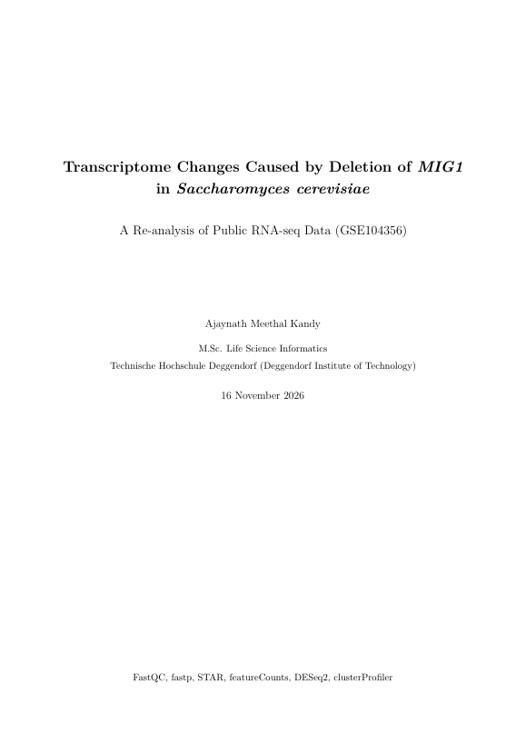
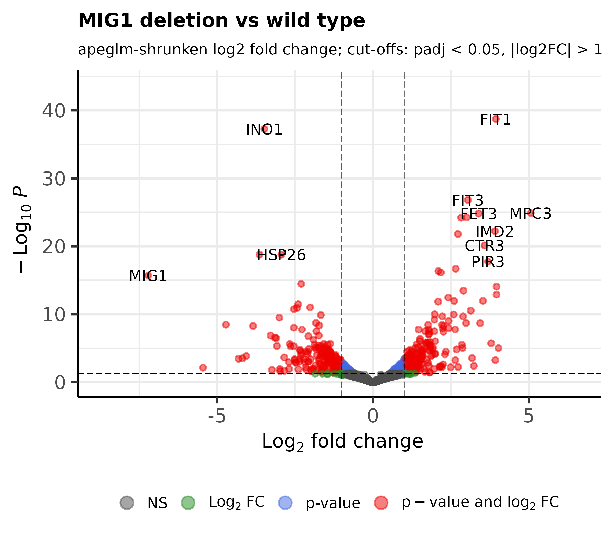
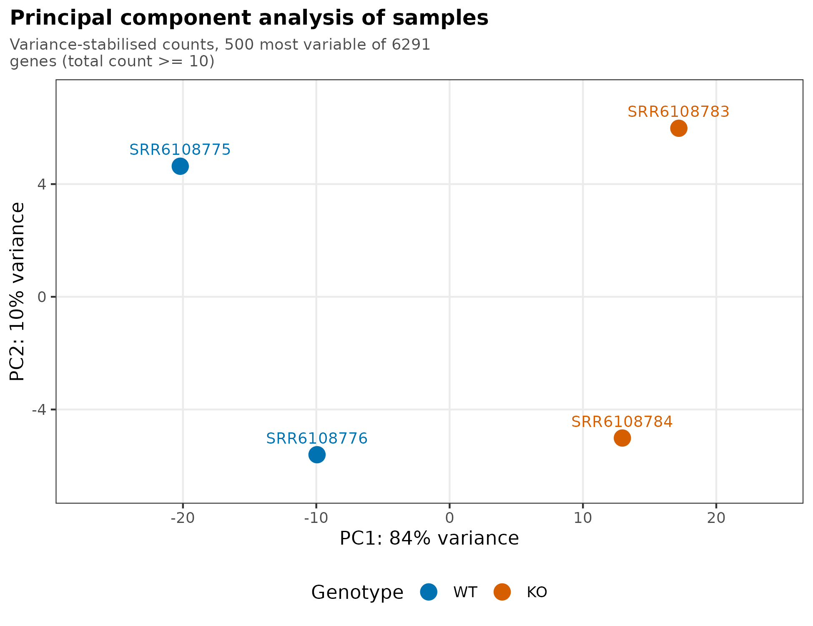

[](https://github.com/ajaynathmk/yeast-mig1-rnaseq/actions/workflows/dry-run.yml)

# Yeast MIG1 deletion RNA-seq: a reproducible Snakemake pipeline

Differential expression analysis of a *mig1Δ* knockout against wild-type *Saccharomyces cerevisiae*, from raw
sequencing reads to GO enrichment. The whole analysis runs as a Snakemake workflow, and the exact software
environment is available as a Docker image. A written report is in
[`docs/report/main.pdf`](docs/report/main.pdf); the figures used in it are in [`figures/`](figures/).

This project is a learning project: every step was first run by hand, checked, and only then turned into a
script and a workflow rule. The manual checks (strandedness test, investigation of a problem sample) are
summarised under [Quality control findings](#quality-control-findings).

## Report

A written report of the analysis (introduction, methods, results, discussion and limitations) is in
[`docs/report/main.pdf`](docs/report/main.pdf). It is written in LaTeX; the source is
[`main.tex`](docs/report/main.tex) with the references in [`references.bib`](docs/report/references.bib),
and every figure comes from the workflow output in [`figures/`](figures/). To rebuild the PDF:

```bash
cd docs/report && latexmk -pdf main.tex
```

[](docs/report/main.pdf)

## Contents

1. [Dataset](#dataset)
2. [Workflow overview](#workflow-overview)
3. [How to run it](#how-to-run-it)
4. [Methods and parameters](#methods-and-parameters)
5. [Quality control findings](#quality-control-findings)
6. [Results](#results)
7. [Limitations](#limitations)
8. [Reproducibility checks](#reproducibility-checks)
9. [Repository layout](#repository-layout)
10. [Troubleshooting](#troubleshooting)
11. [Planned work](#planned-work)
12. [Tools and references](#tools-and-references)

---

## Dataset

| | |
|---|---|
| Source | GEO series **GSE104356** (BioProject **PRJNA412405**) |
| Organism | *Saccharomyces cerevisiae* |
| Samples used | 2 wild type (strain ScY01a): `SRR6108775`, `SRR6108776` |
| | 2 *mig1* knockout: `SRR6108783`, `SRR6108784` |
| Strain | ScY01a, reported as mating-type a and derived from the industrial strain ScY01; *mig1* deleted by KanMX gene replacement (Gan et al. 2021) |
| Growth (as reported by the authors) | YP with 200 g/L glucose, micro-aerobic, 40 °C, harvested after 10 h; RNA-seq in biological duplicates |
| Library | paired-end, 151 bp, unstranded |
| Reference | Ensembl Genomes fungi, release 56, assembly **R64-1-1** (FASTA and GTF) |

MIG1 (systematic name `YGL035C`) is the main glucose-repression transcription factor in yeast, so the
experiment has a built-in positive control: MIG1 itself must disappear in the knockout, and known
glucose-repressed genes should change.

Strain and growth details are taken from the paper's Methods; which culture condition each of the four runs
belongs to still has to be checked against the GEO sample records.

The sample sheet is [`metadata/samples.tsv`](metadata/samples.tsv). It was built from the ENA file report for
the project and contains the download URLs of all FASTQ files.

---

## Workflow overview

```
              ┌─► FastQC + MultiQC (raw reads)
ENA download ─┤
              └─► fastp trimming ──► FastQC + MultiQC (after trimming)
                        │
                        ▼
STAR index (genome + GTF) ──► STAR alignment (per sample)
                        │
                        ▼
      featureCounts (gene-level, read pairs; uses the GTF)
                        │
                        ▼
              count matrix (genes × samples)
                 │                    │
                 ▼                    ▼
          sample QC (PCA,       DESeq2 differential expression
          distances)            + apeglm shrinkage
                                      │
                                      ▼
                            annotation (gene names from the GTF)
                            and volcano plot
                                      │
                                      ▼
                            GO enrichment (BP, MF, CC;
                            up- and down-regulated genes separately)
```

Each box is a Snakemake rule in [`Snakefile`](Snakefile). The rules are linked only by file names, so
Snakemake works out the order itself and re-runs only what is missing or out of date.

| Rule | What it does | Tool |
|---|---|---|
| `download_fastq` | download one FASTQ file, trying https, http, then ftp, and verify its size against ENA | `scripts/download_one.sh` (wget) |
| `download_genome`, `download_gtf` | fetch the reference | wget |
| `fastqc_raw`, `fastqc_trimmed` | per-file quality reports | FastQC |
| `fastp` | adapter removal and trimming | fastp |
| `multiqc_raw`, `multiqc_trimmed` | combined quality reports | MultiQC |
| `star_index` | build the genome index | STAR |
| `star_align` | align each sample, sorted BAM | STAR |
| `featurecounts` | count read pairs per gene | featureCounts |
| `count_matrix` | tidy the counts into a genes × samples table | shell |
| `sample_qc` | PCA, sample distances, correlations | `scripts/01_sample_qc.R` |
| `deseq2` | differential expression, annotation, plots, GO enrichment | `scripts/02_DESeq2.R` |

---

## How to run it

You need about **15 GB of free disk space** (raw reads, trimmed reads, genome index and BAM files) and a
few GB of RAM. The first run downloads about 5 GB of sequencing data.

### Option 1: Docker

The image contains the tools and the workflow code, not the data. Data and results are mounted from your
machine, so they stay on your disk.

```bash
git clone https://github.com/ajaynathmk/yeast-mig1-rnaseq.git
cd yeast-mig1-rnaseq
docker build -t yeast-mig1-rnaseq .

mkdir -p data results
docker run --rm --user $(id -u):$(id -g) -e HOME=/tmp \
  -v $PWD/data:/pipeline/data -v $PWD/results:/pipeline/results \
  yeast-mig1-rnaseq --cores 4
```

- `--user $(id -u):$(id -g)` makes the container write files as you, so the results belong to your user.
- Anything after the image name goes to Snakemake. For a dry run that lists the jobs without running them, use
  `yeast-mig1-rnaseq -n`.

### Option 2: micromamba

```bash
git clone https://github.com/ajaynathmk/yeast-mig1-rnaseq.git
cd yeast-mig1-rnaseq
micromamba create -n yeast-rnaseq -f environment.lock.yml
micromamba activate yeast-rnaseq
snakemake --cores 4
```

Useful Snakemake commands:

```bash
snakemake -n                  # dry run: which jobs would run
snakemake -n --forceall       # dry run as if nothing existed yet (shows the full 42-job plan)
snakemake --cores 4           # run everything that is missing
snakemake --cores 4 -R deseq2 # force one rule (and what depends on it) to run again
```

### Environment files

| File | Purpose |
|---|---|
| `environment.yml` | the packages the project asks for, without versions; short and readable |
| `environment.lock.yml` | every package pinned to an exact version; this is what the Docker image installs |

### Settings

Values that someone may want to change are in [`config.yaml`](config.yaml): sample sheet, reference URLs,
STAR index settings, strandedness, and the significance cut-offs.

---

## Methods and parameters

**Trimming (fastp).** Adapters detected automatically for paired-end reads (`--detect_adapter_for_pe`);
reads shorter than 36 bases after trimming are removed. Duplicates are **not** removed, as is standard for
RNA-seq (it would flatten the dynamic range of highly expressed genes).

**Alignment (STAR 2.7.10b).** Index built with the annotation (`--sjdbOverhang 150`, read length minus one;
`--genomeSAindexNbases 10`, suited to the 12 Mb yeast genome). Alignment with `--alignIntronMax 2000` and
`--alignMatesGapMax 2000`, because yeast introns are short, and `--limitBAMsortRAM 3000000000` for the BAM
sorting step.

**Counting (featureCounts 2.1.1).** `-p --countReadPairs -s 0 -t exon -g gene_id`: read pairs are counted
once per fragment, the library is treated as **unstranded**, exons are summed per gene. Strandedness was
determined by experiment, not assumed: see the QC findings.

**Sample QC.** Genes with a total of at least 10 reads are kept (6,291 genes) and the counts are
variance-stabilised (`vst`, blind to the design). The PCA uses the 500 most variable of these genes (the
`plotPCA` default); sample distances are Euclidean distances between the variance-stabilised profiles of all
6,291 genes.

**Differential expression (DESeq2).**
- Design `~ condition` with wild type as the reference level.
- Genes are kept if they have at least 10 reads in at least as many samples as the smallest group (here 2).
  This leaves **5,969** genes. A simpler rule (a total of 10 reads over all samples) would keep 6,291, which
  also admits genes with reads in only one sample. The sample QC (PCA, distances, correlations) uses this
  simpler filter, because it only needs to drop empty genes; the DESeq2 test uses the stricter one.
- Design `~ replicate + condition` was considered and rejected: with four samples it leaves one residual
  degree of freedom, and the replicate labels are arbitrary.
- Wald test, Benjamini–Hochberg adjustment.
- Fold changes are shrunk with **apeglm**. A gene is called significant if **padj < 0.05 and |shrunken log2
  fold change| > 1**.
- The result table also contains the unshrunken fold change, the gene name and the gene biotype from the GTF.

**GO enrichment (clusterProfiler).** `enrichGO` with `org.Sc.sgd.db`, gene identifiers as `ORF`, Benjamini–
Hochberg adjustment (cut-off 0.05). The background ("universe") is every gene that was tested (non-missing
adjusted p-value), not the whole genome. Up- and down-regulated genes are tested separately, for the three
ontologies Biological Process, Molecular Function and Cellular Component.

**Figures.** Every plot is written as a separate PNG (300 dpi) and PDF file; the PNG files used in the report
are copied to [`figures/`](figures/).

---

## Quality control findings

These are the decisions the data forced, and they are why the pipeline looks the way it does.

**1. The library is unstranded.** Counting the same BAM files with `-s 0`, `-s 1` and `-s 2` assigned 81–84%
of read pairs with `-s 0` and about 46% with either stranded setting. The three settings were compared before
any counting was done for the analysis.

**2. Sample SRR6108784 (knockout replicate 2) is of lower quality.**
- Only 36.5% of its reads map uniquely, and 61.7% are discarded by STAR as "too short".
- The unmapped reads contain concatemers of the SMART primer sequence (about 20% of unmapped pairs carry the
  primer motif). Ten randomly chosen unmapped reads without the primer motif (mate 1, at least 100 nt) were
  searched with BLASTn at the NCBI web service: their best-scoring hits were *Drosophila* species, mainly
  *D. melanogaster*, which indicates contamination with foreign RNA. The BLAST database, settings and search
  date were not recorded. The GC content of the unmapped reads is about 49%, unlike yeast.
- It yields about 3.0 million counted read pairs against 6.3–7.0 million for the other samples, and a
  DESeq2 size factor of 0.53 against 1.23–1.27.
- In the PCA (500 most variable genes), PC1 (83.7% of the variance) separates knockout from wild type.
  `SRR6108784` is the knockout sample closer to the wild type on PC1 (13.0 against 17.2 for `SRR6108783`);
  PC2 (9.8%) separates `SRR6108775` and `SRR6108783` from `SRR6108776` and `SRR6108784`.
- The sample was **kept in the analysis**, since only four samples exist. All 389 significant genes have both
  knockout samples on the same side of both wild-type samples. This is a necessary check, not a proof; under
  no real difference, the chance of that ordering for one gene is one in three.
- The investigation (STAR runs with default and relaxed filters, BLAST of unmapped reads) is described in
  the report in [`docs/report/`](docs/report/).

**3. DESeq2 diagnostics.** The dispersion fit, the MA plot and the p-value histogram are written as three separate
files, `dispersion.png`, `MA_plot.png` and `pvalue_histogram.png` (copies are in [`figures/`](figures/)). 28 genes were flagged as dispersion outliers, mostly heat-shock chaperones
and metabolic genes.

---

## Results





**Overview.** Deleting MIG1 changes the expression of **389 of 5,969 tested genes** (193 up, 196 down;
padj < 0.05, |log2FC| > 1). Without the fold-change requirement, 639 genes pass padj < 0.05 (299 up, 340 down).

**Positive controls.**

| Gene | Observation |
|---|---|
| *MIG1* (`YGL035C`) | almost absent in the knockout: shrunken log2 fold change about −7.2 (unshrunken −7.39; about 150-fold lower), padj 2e-16 |
| *HXT2*, *HXK1* | glucose-repressed genes, up in the knockout (log2FC +2.7 and +4.0) |
| *SUC2* | modestly up (log2FC +0.8, padj 0.008, below the 2-fold cut-off) |
| *GAL* genes | unchanged |

**Strongest changes.** FIT1, INO1, FIT3, MPC3, FET3, SIT1, PHO84, IMD2, IZH4 and CTR3 are among the top
genes. Of the 389 significant genes, 370 are protein-coding, 12 snoRNA, 3 ncRNA, 2 transposable elements,
1 pseudogene and 1 tRNA.

**GO enrichment** (Biological Process, Molecular Function and Cellular Component agree):
- **Up in the knockout:** metal ion (iron, copper, zinc) transport, hexose and sugar transport, carbon
  metabolism, cell wall and vacuole genes, and the pheromone and mating response.
- **Down in the knockout:** the endoplasmic reticulum protein-folding machinery (ER stress, unfolded protein
  binding, disulfide oxidoreductases, peroxidases, ER lumen).

These are patterns in the data. This analysis does not show *why* the knockout has a metal-starvation-like
signature.

**Result files** (generated by the workflow in `results/`; not tracked in the repository):

| File | Content |
|---|---|
| `counts/count_matrix.tsv` | raw gene counts, genes × samples |
| `sample_qc/` | PCA, distance heatmap, correlations, counted pairs per sample |
| `deseq2/deseq2_results_annotated.csv` | all tested genes: fold changes, p-values, name, biotype, direction |
| `deseq2/normalized_counts.csv` | size-factor-normalised counts |
| `deseq2/volcano.png`, `dispersion.png`, `MA_plot.png`, `pvalue_histogram.png` | plots (PNG and PDF) |
| `deseq2/GO_{BP,MF,CC}_{up,down}.csv` | enrichment tables, plus dot plots where terms were found |
| `multiqc_raw/`, `multiqc_trimmed/` | combined read quality reports |

---

## Limitations

- **Two replicates per group.** The test has little power, and the results should be read as
  hypothesis-generating.
- **Sample SRR6108784** is contaminated and has about half the usable reads of the others (see above). It
  agrees with the other knockout sample on every significant gene, but a leave-one-out analysis has not yet
  been done.
- **The pheromone and mating up-regulation is unexplained.** We found no evidence of a mating-type difference
  between the strains, but the check is indirect: the silent mating-type loci share sequence with the
  active one, so reads there cannot settle it. The authors report the wild type as mating-type a.
- **Strain background and growth conditions.** ScY01a is a derivative of an industrial strain, while the
  reference is the laboratory strain S288c, so strain-specific sequence differences may lower mapping rates.
  The culture conditions come from the paper's Methods and have not been matched to the GEO sample records of
  these four runs.
- **snoRNA and tRNA results** (about 13 genes) are unreliable, since the library type captures them poorly.
- The authors report biological duplicates (separate cultures) for each strain; this was not checked against
  the GEO sample records.
- **No external validation.** The results have not been compared with the authors' published gene lists or
  validated by an independent method.

---

## Reproducibility checks

| Check | Outcome |
|---|---|
| Fresh clone of the repository, whole workflow from the download step | count matrix identical (same numbers; column order differs because it follows the sample sheet) |
| Same run, DESeq2 results | same genes, same direction labels, same GO tables; numerical differences up to about 3e-6 (convergence tolerance of the model fit and of apeglm) |
| Docker image, QC and DESeq2 steps from the count matrix | identical to the manual analysis (maximum absolute difference 0) |

---

## Repository layout

```
├── Snakefile                  the workflow
├── config.yaml                settings (sample sheet, URLs, cut-offs)
├── Dockerfile                 image with the pinned environment and the workflow
├── environment.yml            requested packages
├── environment.lock.yml       exact versions
├── metadata/                  sample sheet and ENA file lists
├── scripts/
│   ├── download_one.sh        robust single-file download (https → http → ftp, size check)
│   ├── 01_sample_qc.R         PCA, sample distances, correlations
│   └── 02_DESeq2.R            differential expression, annotation, plots, GO enrichment
├── figures/                   figures used in the report and in this README
└── docs/
    └── report/                LaTeX report (main.tex, main.pdf)
```

Not in the repository (listed in `.gitignore`): `data/` (raw and trimmed reads, reference, STAR index),
`results/` (written by the workflow), BAM files, the exploratory notebook and manual-check notes, and
Snakemake's working folders.

---

## Troubleshooting

- **STAR stops during BAM sorting with a message about `--limitBAMsortRAM`.** The sort needs more memory than
  STAR assumed. The workflow passes `--limitBAMsortRAM 3000000000` (3 GB); raise it if your machine allows.
  A leftover `_STARtmp` folder also stops STAR from starting; the rule removes it before each run.
- **A download fails or stalls.** ENA serves some files only over some protocols. `scripts/download_one.sh`
  tries https, http and ftp in turn and resumes partial files; it counts a file as complete only when its
  size equals the size ENA reports (`metadata/fastq_sizes.tsv`). Snakemake deletes the partial output of a
  failed job; to keep partial files for resuming, run with `--keep-incomplete`.
- **`Permission denied` when running in Docker.** The container user is not your user. Use
  `--user $(id -u):$(id -g) -e HOME=/tmp` as shown above.
- **`micromamba create` reports conflicts or `repo.anaconda.com`.** The environment files use only
  `conda-forge` and `bioconda` (`nodefaults`). Do not add Anaconda's default channel to your configuration.
- **Snakemake says "Nothing to be done" although you changed an R script.** Snakemake only watches the
  files that a rule lists as inputs. Force the rule with `-R sample_qc` or `-R deseq2`.

---

## Planned work

- Leave-one-out analysis without `SRR6108784`, and a model with a replicate term, as a sensitivity check.
- Gene set enrichment on the ranked gene list, and KEGG pathways.
- Match the four runs to the GEO sample records (condition, replicate) and check the strain background.

---

## Tools and references

Snakemake 7.32.4, STAR 2.7.10b, featureCounts (Subread) 2.1.1, fastp, FastQC, MultiQC, DESeq2, apeglm,
clusterProfiler, enrichplot, EnhancedVolcano, and the *S. cerevisiae* annotation package `org.Sc.sgd.db`.
BLASTn at the NCBI web service was used for the contamination check. Exact versions of everything are in
[`environment.lock.yml`](environment.lock.yml).

- Mölder F, et al. Sustainable data analysis with Snakemake. *F1000Research* 2021.
- Dobin A, et al. STAR: ultrafast universal RNA-seq aligner. *Bioinformatics* 2013.
- Liao Y, Smyth GK, Shi W. featureCounts: an efficient general purpose program for assigning sequence reads
  to genomic features. *Bioinformatics* 2014.
- Love MI, Huber W, Anders S. Moderated estimation of fold change and dispersion for RNA-seq data with
  DESeq2. *Genome Biology* 2014.
- Zhu A, Ibrahim JG, Love MI. Heavy-tailed prior distributions for sequence count data: removing the noise
  and preserving large differences. *Bioinformatics* 2019.
- Chen S, et al. fastp: an ultra-fast all-in-one FASTQ preprocessor. *Bioinformatics* 2018.
- Ewels P, et al. MultiQC: summarize analysis results for multiple tools and samples in a single report.
  *Bioinformatics* 2016.
- Wu T, et al. clusterProfiler 4.0: a universal enrichment tool for interpreting omics data. *The
  Innovation* 2021.
- Gan Y, Qi X, Lin Y, Guo Y, Zhang Y, Wang Q. A hierarchical transcriptional regulatory network required for
  long-term thermal stress tolerance in an industrial *Saccharomyces cerevisiae* strain. *Frontiers in
  Bioengineering and Biotechnology* 9 (2022), 826238. doi:10.3389/fbioe.2021.826238 (the study behind GSE104356).
- Altschul SF, et al. Basic local alignment search tool. *Journal of Molecular Biology* 1990.
- Blighe K, Rana S, Lewis M. EnhancedVolcano: publication-ready volcano plots with enhanced colouring and
  labeling. R/Bioconductor package, version 1.28.2, 2025. doi:10.18129/B9.bioc.EnhancedVolcano
- Carlson M. org.Sc.sgd.db: genome wide annotation for yeast. R/Bioconductor package, version 3.22.0, 2025.
